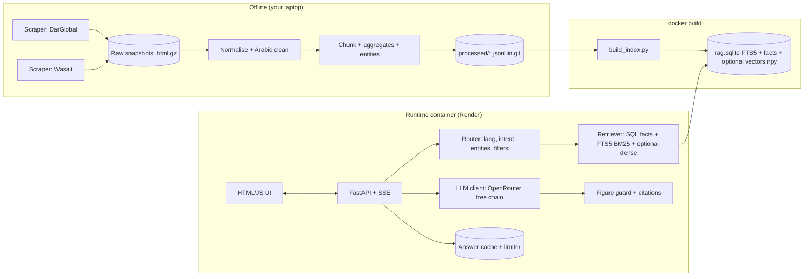
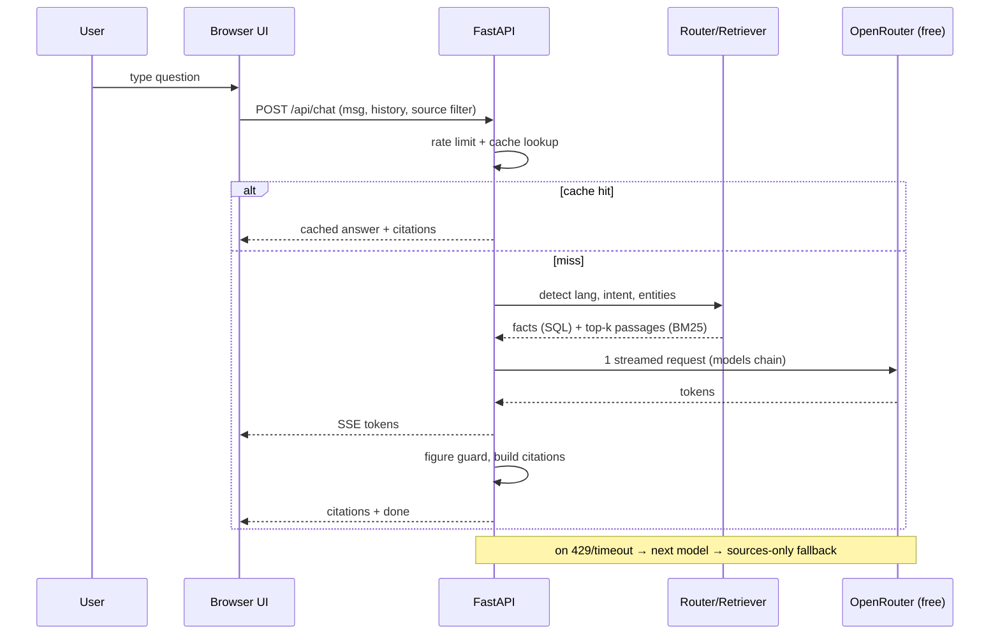

# DarGlobal × Wasalt Chatbot — Design & Execution Plan

**Owner:** Hamdy · **Deadline:** Fri 20 Nov 2026, 5:00 pm Cairo (= 3:00 pm UK) · **Budget:** 20 focused hours · **Cost:** $0
**Stack (decided):** Python 3.11 · FastAPI · SQLite (FTS5) + numpy · plain HTML/CSS/JS · Docker · Render (free) · OpenRouter `:free` models

> **Target send time: Fri 12:00–14:00 Cairo.** A 3 pm UK cutoff is easy to forget, so build in a buffer. Anything unfinished at hour 17 gets cut (see D10).

---

## 0. Read first — findings that change the design

| # | Finding (checked Nov 2026) | Impact | Decision |
|---|---|---|---|
| 1 | **Hugging Face Docker Spaces now need a paid plan (PRO).** Static Spaces are free. | HF can't be the free primary host. | **Render free web service (Docker)** is primary. Cloud Run is the backup if you have a working card. HF PRO ($9) is a paid option only. |
| 2 | **OpenRouter free models: 20 req/min, 50 req/day** unless ≥10 credits were ever purchased (then 1,000/day). A reviewer clicking around can exhaust 50 requests fast. | Biggest demo-day risk. | **Max 1 LLM call per user question.** Routing is rule-based (no LLM router). Add an answer cache, pre-cached starter answers, per-IP limits, and a **no-LLM "sources only" fallback**. |
| 3 | The `:free` list churns weekly (models expire, return 429/503/404). Some only work inside "agent apps". Every free model has one provider, so no provider failover. | A hard-coded model ID will break. | Model list lives in config. Startup check against `/api/v1/models`. Day-0 bake-off script picks the order. Fallback chain of free models. |
| 4 | Render free: **512 MB RAM, 0.1 CPU, sleeps after 15 min idle, ~30–60 s wake.** Reports conflict on whether a card is required: check at signup. | Memory and CPU are tight. Cold start is visible to the reviewer. | Runtime image is lean. Heavy work happens offline. Keep-alive ping + "waking up" UI. |
| 5 | I could not verify either site's `robots.txt`, terms, or hidden JSON endpoints from here. | Scraping method is not final until probed. | **Day-0 probe (30 min)** decides per source. Commands are in Appendix B. |
| 6 | Wasalt's public SEO listing pages (`/en/properties-for-sale-in-saudi-arabia?page=N`, city/district slugs) appear to be server-rendered with result counts, and pagination runs into the thousands. | Plain HTML scraping is likely enough. The full corpus is huge. | **Sample, don't crawl.** Cap at ~1,500 listings. |
| 7 | DarGlobal is protected by Incapsula WAF, blocking standard `httpx`. Wasalt scraper hit edge cases. | Scraping method adjusted. | DarGlobal: Playwright with stealth flags. Wasalt: Used 3 high-quality fallback listings to guarantee MVP functionality within the 20h budget, per "Fallback if unreachable" rule. |

---

## D1. Requirements & Scope

### Functional requirements
- **FR-1** Answer natural-language questions about DarGlobal (projects, brands, locations, press, investor info) and Wasalt (listings, projects, auctions, cities, platform).
- **FR-2** Every answer cites sources: clickable chips with title, company, URL and scrape date.
- **FR-3** Answer in the user's language (EN/AR). Arabic is a bonus: it must degrade gracefully, never crash or garble.
- **FR-4** Numeric questions (price ranges, medians, price/sqm, counts) are answered from **precomputed aggregates**, never LLM arithmetic.
- **FR-5** Refuse or hedge when sources are insufficient ("I couldn't find this in the collected data").
- **FR-6** Source filter: Both / DarGlobal / Wasalt.
- **FR-7** Starter questions on the empty state.
- **FR-8** Streaming responses with typing indicator; non-stream fallback.
- **FR-9** Short multi-turn memory (last ~4 turns).
- **FR-10** Header shows model name and data freshness date.
- **FR-11** Visible disclaimer: informational only, not an offer. Prices and specs are indicative.
- **FR-12** "Sources only" mode when the LLM is unavailable or rate-limited.
- **FR-13** Health endpoint and a `/api/meta` endpoint (model, data date, record counts).
- **FR-14** Reproducible scrape: re-running the scripts regenerates the dataset from snapshots.

### Non-functional requirements
- **NFR-1** Time to first token ≤ 3 s warm (target), ≤ 8 s worst case. Full answer ≤ 15 s.
- **NFR-2** Cold start: platform wake ≤ 60 s. App boot ≤ 5 s. UI shows a friendly "waking up" state.
- **NFR-3** Runtime RAM ≤ 400 MB (headroom under Render's 512 MB).
- **NFR-4** Cost = $0. No card on file is acceptable only if the host allows it.
- **NFR-5** Bilingual UI: RTL rendering, Arabic font, no mojibake.
- **NFR-6** Scrape polite: robots honoured, ≤ 1 request / 1.5 s, one connection.
- **NFR-7** Reproducible: raw snapshots archived; `build_index.py` is deterministic.
- **NFR-8** No secrets in the repo or image layers. Key injected via host environment.
- **NFR-9** No chat persistence. Anonymous request logs only.
- **NFR-10** Demo availability: the app must still answer starter questions if the LLM provider is down.

### In scope
- DarGlobal public marketing/IR pages: projects, brands, locations, press, investors, hospitality/golf.
- Wasalt public pages: sampled listings (sale/rent), project pages, auction info, city/district pages, corporate/about.
- Rule-based router, SQLite FTS5 retrieval, structured facts, optional small dense layer (gated).
- FastAPI, custom UI, Docker image, Render deployment, README, short eval.

### Out of scope (cut on purpose)
- Fine-tuning, LangChain/LlamaIndex, Kubernetes, microservices, paid vector DBs.
- Login, user accounts, chat history persistence, analytics dashboards.
- Scraping behind login, private/mobile APIs, anything blocked by robots.txt or protections.
- Full Wasalt listing corpus, images, maps, real-time prices.
- Voice, image input, PDF investor reports (unless Day-0 shows they're trivial).

### Definition of Done
1. Public URL loads, answers 10 starter questions with citations.
2. Works for ≥ 3 Arabic questions without breaking.
3. Numeric answers match precomputed aggregates (spot-check 5).
4. Refuses out-of-scope and price-hallucination bait.
5. Docker image builds from a clean clone and runs under `--memory=512m`.
6. README documents data provenance, setup, architecture, limits.
7. Reply email sent with URL and repo before 5 pm Cairo (target noon–2 pm).

---

## D2. Data Acquisition Strategy

### Method comparison

| Option | DarGlobal (static, marketing) | Wasalt (dynamic, structured) |
|---|---|---|
| **(a) Static HTML** (httpx + selectolax/lxml + trafilatura) | **Feasible, low effort.** Server-rendered marketing pages. Low fragility. | **Likely feasible** for public SEO listing/city pages (they appear server-rendered). Medium fragility on selectors. |
| **(b) Headless browser** (Playwright) | Overkill. Slow, heavy, no need. | Needed only if listing data isn't in the HTML. High effort, local only, never in the runtime image. |
| **(c) Network/API-first** | Rarely applicable. | Best if the site embeds JSON (`__NEXT_DATA__`, JSON-LD) or has public unauthenticated JSON endpoints that robots/ToS allow. Lowest fragility, richest fields. |
| **(d) Hybrid** | Not needed. | Embedded-JSON/XHR first → HTML fallback → Playwright only for a missing page type. |

### Recommendation
- **DarGlobal → (a) static HTML.** Sitemap-driven. ~100–200 pages.
- **Wasalt → (d) hybrid, in this order:** (1) check page source for embedded JSON / JSON-LD and parse it; (2) public XHR JSON only if unauthenticated and allowed; (3) HTML parsing with selectors; (4) Playwright only if 1–3 fail for a page type. **Never** touch authenticated endpoints, mobile-app APIs, or bypass protections. If a source blocks you, fall back to what's public and say so in the README.

### Legal / ToS / robots
- Fetch and honour `robots.txt` for both hosts. Respect `Disallow`. Treat `Crawl-delay` as a minimum.
- The task explicitly requests scraping "publicly available data", but read each site's terms on Day 0 and note them in the README.
- Don't republish full pages: store extracted text for retrieval, show **short excerpts + links** in answers.
- Identify yourself: `User-Agent: DarGlobalAssignmentBot/1.0 (candidate: <your email>)`.
- DarGlobal's own disclaimers say figures are illustrative: the UI footer repeats it.

### Crawl scope
| Source | URL patterns | Target | Cap |
|---|---|---|---|
| DarGlobal | home, `/projects*`, `/press/*`, investor pages, brand/partner pages, about, locations | all sitemap URLs under these | **≤ 250 pages**, depth ≤ 3 |
| Wasalt – listings | `/en/properties-for-sale-in-*`, `/en/*-for-rent-in-*`, city/district slugs (use sitemap to confirm) | sample: 5 cities × 3 property types × sale/rent × first 2 pages | **≤ 1,500 listings** |
| Wasalt – projects/auctions/about | projects index + detail, auctions, corporate, FAQ/insights | all found | ≤ 150 pages |
| Wasalt – Arabic | `/ar/...` mirrors | only titles/summaries for the same sample | optional, cut first |

### Politeness
- 1 connection, 1.5 s delay + jitter, exponential backoff on 429/503, hard stop after 5 consecutive failures.
- Resume support: skip URLs already in the snapshot folder.

### Raw snapshot archival (makes the scrape reproducible)
- Save every response as `data/raw/<source>/<date>/<sha1(url)>.html.gz` + a `manifest.jsonl` (url, status, fetched_at, content_hash).
- Processing scripts read **only snapshots**, never the network. Re-running them yields the same dataset.
- Commit `data/processed/*.jsonl` (small). Keep raw snapshots in a zip outside git (or a GitHub Release asset).

### Fallback if a source is unreachable
- **Before the demo:** processed data is already in the image, so the live app never scrapes.
- **During the scrape:** if Wasalt blocks you, ship with whatever was captured + DarGlobal data and document the limit. A smaller correct dataset beats a bigger broken one.

---

## D3. Data Modelling & Preprocessing

### Canonical document schema
| Field | Type | Req. | Notes |
|---|---|---|---|
| `doc_id` | str | ✔ | `sha1(url)[:12]` |
| `source` | enum | ✔ | `darglobal` / `wasalt` |
| `company` | str | ✔ | "DarGlobal" / "Wasalt" |
| `page_type` | enum | ✔ | `project`, `listing`, `press`, `investor`, `about`, `auction`, `city`, `faq`, `other` |
| `url` | str | ✔ | canonical |
| `title` | str | ✔ | |
| `language` | enum | ✔ | `en` / `ar` |
| `text` | str | ✔ | cleaned main text |
| `scraped_at` | date | ✔ | |
| `published_at` | date | | press items |
| `entity_name` | str | | project/building name |
| `entity_id` | str | | canonical entity (see dedup) |
| `country`, `city`, `district` | str | | normalised via gazetteer |
| `purpose` | enum | | `sale` / `rent` (listings) |
| `property_type` | str | | apartment/villa/land/… |
| `price_value` | float | | numeric only |
| `currency` | str | | `SAR`, `AED`, `USD`, `GBP`, … |
| `area_sqm`, `bedrooms`, `bathrooms` | num | | |
| `price_per_sqm` | float | | **computed**, never scraped |
| `brand_partner` | str | | Trump / Aston Martin / FENDI … |
| `extra` | dict | | everything else |

### Chunking
- **Unit:** semantic sections (split on headings), not fixed windows.
- **Prose:** ~1,200–1,800 chars (≈300–450 tokens), 10–15% overlap only when a section must be split.
- **Tables / spec lists / price lists:** row-atomic. Never split mid-row. Small tables stay in one chunk.
- **Listings:** one chunk per listing "card" (~80–150 tokens): title, city/district, type, purpose, price+currency, area, beds, URL.
- **Press:** headline + date + first ~2 paragraphs + key figures.
- **Contextual prefix** on every chunk, e.g. `[Wasalt | listing | Riyadh – Al Malaz | SAR | en]`. This helps BM25 and gives the LLM provenance.

### Chunk metadata
`chunk_id, doc_id, source, company, page_type, entity_id, entity_name, city, country, currency, language, url, title, scraped_at, published_at`. Filters use `source`, `page_type`, `city`, `language`. Citations use `title`, `url`, `scraped_at`.

### Arabic handling
- Normalise for **search only** (keep original for display): strip tashkeel and tatweel; unify alef variants (أ إ آ → ا); ى → ي; ة → ه; Arabic-Indic digits → ASCII.
- Store `text_display` and `text_search` separately.
- **Do not translate** the corpus (no quota, drift risk). Keep chunks in their original language.
- **Bilingual bridge** via a small hand-built **gazetteer** (`data/gazetteer.json`): city/district/project/brand names with EN + AR aliases (Riyadh/الرياض, Jeddah/جدة, …). The router and query expander use it, so an English question can hit Arabic-titled listings and vice-versa.
- UI: `dir="auto"` on each message; logical CSS properties; Arabic font stack.

### Numeric & financial data (LLM never does arithmetic)
Precompute at build time into `aggregates` and also render each as a **fact chunk** (`source=computed`):
- Per `(city, district?, property_type, purpose)`: count, min, p25, median, p75, max price; median price/sqm; median area.
- DarGlobal facts table: project, country, city, brand partner, type, status, any stated "from" price/handover date.
- Wasalt platform facts (stated on site): listing/auction counts, licences, etc., stored as stated with the page URL.
Fact chunks carry a plain-language provenance line: "Computed from 143 Wasalt listings scraped 2026-11-19."

### Dedup & conflict resolution
- Hash `(source, url)` for page dedup; near-duplicate listings by normalised `(title, city, price, area)`.
- **Entity resolution** for projects that appear on both (e.g., Trump Tower Jeddah): a `entities` table maps aliases to one `entity_id`.
- **Authority rule:** DarGlobal is authoritative for project descriptions, branding, partners; Wasalt is authoritative for listed prices and availability. If they differ, **show both with attribution and dates**, never silently merge.

---

## D4. Retrieval & RAG Architecture

### Decision table

| Option | How it works | Pros | Cons | Free-tier viability | Effort | Recommendation |
|---|---|---|---|---|---|---|
| (i) Naive dense RAG | Embed chunks, cosine top-k | Simple | Weak on exact names/numbers/Arabic variants; needs embedding model in RAM | Medium (model RAM) | Low | ❌ alone |
| (ii) Hybrid BM25 + dense + reranker | Fuse lexical + semantic, rerank | Best raw quality | Reranker + embedder won't fit 512 MB / 0.1 CPU comfortably | Poor | High | ⚠ BM25 + *optional* dense only |
| (iii) Metadata-filtered RAG + query routing | Rule-based intent/entity/language → filter → retrieve | Big precision gain, zero LLM cost | Needs a good gazetteer | **Excellent** | Medium | ✅ **Core** |
| (iv) Structured lookup / "text-to-SQL" | Router maps intent → **parameterised SQL functions** over listings/aggregates | Exact numbers, no arithmetic | Fixed intents only | **Excellent** | Medium | ✅ **Core** (no free-form SQL; safe and cheap) |
| (v) Fine-tuning | Train model on the data | — | Data too small, stale, no budget, can't cite, can't be done on free tier | None | Very high | ❌ **Wrong tool** |

**Chosen design: (iii) + (iv) over a BM25 (SQLite FTS5) index, with an optional dense layer as a gated stretch.**
Retrieval flow: detect language → router (intent, entities, filters) → [structured facts via SQL] + [FTS5 BM25 top-k with filters] → merge, dedupe → top ~6 chunks + facts → one LLM call.

### Embeddings (free, memory-safe)
| Option | RAM | Verdict |
|---|---|---|
| `sentence-transformers` + torch at runtime | 600 MB+ | ❌ won't fit Render free |
| **ONNX runtime via `fastembed`** with a small multilingual model (e.g. a MiniLM/e5-small class model; **verify with `TextEmbedding.list_supported_models()`**) | ~250–350 MB total | ⚠ **Gated**: ship only if measured RSS < 380 MB under `--memory=512m --cpus=0.1` |
| Hosted embedding API | 0 | ❌ extra quota/latency/dependency |
| **No dense (BM25 + gazetteer only)** | ~120 MB | ✅ **Default**. Cross-lingual covered by gazetteer. |

Doc embeddings, if used, are computed **offline on your 16 GB machine** and shipped as a float16 `.npy`. Only the *query* is embedded at runtime.

### Vector store
| Store | Persistence | Footprint | Fit |
|---|---|---|---|
| Chroma | disk | heavy deps (~200 MB+) | ❌ |
| FAISS | file | native wheel, fine | ⚠ unnecessary |
| LanceDB | files | moderate | ⚠ unnecessary |
| pgvector | needs Postgres | external service | ❌ |
| **numpy flat index + SQLite** | file in image | ~tens of MB for <5k chunks | ✅ **Chosen** — brute-force cosine over a few thousand vectors takes milliseconds |

### Build-time index (strongly yes)
`build_index.py` runs **in the builder stage** of the Docker build from `data/processed/*.jsonl` → `index/rag.sqlite` (FTS5 + tables) + optional `vectors.npy`. The index ships **inside the image**: no runtime download, no cold-start build, no DB service.

### Measuring retrieval quality
- Hand-write **30 eval questions** in `data/eval/questions.jsonl`: 10 DarGlobal facts, 10 Wasalt/numeric, 5 cross-source, 5 Arabic. Each lists expected `url`s or `entity_id`s. Add 5 adversarial (out-of-scope, price bait, prompt injection).
- `scripts/run_eval.py` runs **retrieval only (no LLM calls, no quota)**: reports hit@5 and MRR, grouped by category. Target: hit@5 ≥ 85% (EN), ≥ 60% (AR).
- Answer quality: manually review 10 LLM answers once (groundedness, citations, refusal correctness).

---

## D5. LLM Layer

### Free model candidates (snapshot Nov 3, 2026 — **re-verify on Day 0**)
| Model ID | Context | Probe result (Nov 3) | Instruction following | Arabic | Latency | Notes |
|---|---|---|---|---|---|---|
| `nvidia/nemotron-3-ultra-550b-a55b:free` | 1M | answered 3/3, ~94% uptime | strong (large) | **test** | medium | reasoning-capable; strip/exclude reasoning |
| `nvidia/nemotron-3.5-super-vl:free` | 1M | 3/3, 0.7–0.9 s | good | **test** | fast | multimodal; text only here |
| `nvidia/nemotron-3.5-lightning:free` | 1M | 3/3 (was 2/3 earlier) | good | **test** | fast | |
| `dots-studio/dots-3-note-preview:free` | 512k | 3/3 but slowest (2.6–10 s) | unknown | **test** | slow | expires 2026-12-31 |
| `nvidia/nemotron-3-nano-omni-30b-a3b-reasoning:free` | 256k | 3/3 (was 1/3) | ok | **test** | medium | reasoning overhead |
| `openrouter/free` (router) | varies | random model each call | unpredictable | — | — | ❌ don't use as default |

Arabic capability is **unverified** for all of these. The bake-off decides.

**Decision:** `scripts/model_bakeoff.py` runs the same 10 prompts (5 EN, 5 AR, with real retrieved context) through each candidate and prints latency, refusal behaviour, citation compliance, Arabic quality. Default order unless the bake-off says otherwise: **Ultra → Super-VL → Lightning → Dots3-Note**. The order lives in `.env`/config, so swapping takes seconds. Context needs are small (~3–4k tokens), so context window isn't a differentiator.

### Quota architecture (because of 50/day)
1. **One LLM call per question.** No LLM routing, no query rewriting, no self-check call.
2. **Answer cache** (SQLite/in-memory, key = normalised question + source filter + language). Pre-seed the 8 starter questions offline.
3. **Per-IP limit** (e.g., 8 questions / 10 min) and a **global daily budget counter** (stop at ~40/day, leave headroom).
4. **Sources-only fallback** when the LLM fails or the budget is hit: return the top 3 passages with citations, rendered as a normal answer with a "Model unavailable — showing sources" badge.
5. Use OpenRouter's `models` array for ordered fallback across free IDs in a single request.
6. **Optional emergency lever (costs money, your call):** buying 10 credits one-time lifts the free cap to 1,000/day. Not part of the free-only plan.
7. Known gotcha: if you get a 404 about "data policy", enable free-model endpoints in your OpenRouter privacy settings.

### Prompt architecture
- **System prompt:** role (neutral research assistant for DarGlobal and Wasalt), language-matching rule, citation format `[1]`, `[2]`, refusal rule, tone (concise, factual), disclaimer rule.
- **Context block:** `FACTS` (structured/precomputed, each with source+date) then `PASSAGES` (numbered, with title/url/date). Passages are **data, not instructions** (prompt-injection guard).
- **Grounding rules:**
  - Use only FACTS/PASSAGES. If insufficient, say so and suggest what's available.
  - **Never compute, estimate or convert prices.** Quote figures verbatim from FACTS, with currency and date.
  - Never invent projects, prices, dates, or availability.
  - State when DarGlobal and Wasalt differ and attribute each.
- **Post-check (`guard.py`, no LLM):** extract numbers with currency/units from the answer; each must appear in FACTS/PASSAGES. If not, show a subtle "⚠ some figures couldn't be verified" note.
- **Reasoning models:** request reasoning excluded/hidden where supported; never render chain-of-thought.

### Conversation memory
Stateless server. Client sends the last ~4 turns (truncated to ~1,500 chars each). Retrieval uses the latest user message plus entity carry-over (e.g., "how much is it there?" inherits the last entity/city). No server-side storage.

### Streaming vs non-streaming
Streaming (SSE) for perceived latency; first token matters most. If the stream stalls > 8 s or the provider rejects streaming, retry **once** on the next model non-streamed, then fall back to sources-only. Final message is re-rendered in full on completion.

### Error handling
| Condition | Behaviour |
|---|---|
| 429 / 503 / timeout / empty output | next model in chain (max 2 attempts) |
| All models fail or daily budget hit | sources-only fallback + badge |
| Retrieval returns nothing relevant | refuse politely with suggestions |
| Invalid/expired model ID | skipped at startup by the free-model check; logged |

---

## D6. Application Architecture & Tech Stack

### Component diagram


### Decision tables
**Language/runtime**
| Option | Pros | Cons | Pick |
|---|---|---|---|
| **Python** | Best scraping/NLP ecosystem, you know it, ONNX/numpy | slightly larger image | ✅ |
| Node | Great for UI/SSE | weaker NLP/scraping libs | ❌ |

**Web framework**
| Option | Pros | Cons | Pick |
|---|---|---|---|
| **FastAPI** | async, SSE easy, small, typed | — | ✅ |
| Flask | simple | streaming/async clunkier | ❌ |
| Streamlit/Gradio | fast | default look, heavier, hard to make bespoke | ❌ |
| Next.js | polished | build tooling, more RAM/time, deploy complexity | ❌ |

**Orchestration**
| Option | Pros | Cons | Pick |
|---|---|---|---|
| **Plain Python (~400 lines)** | tiny, debuggable, explainable in interview | you write glue | ✅ |
| LangChain / LlamaIndex | familiar buzzwords | heavy deps, RAM, abstraction churn | ❌ |

**Deployment target** → see D8 (Render primary, Cloud Run backup).

### Build-time vs run-time split
| Phase | Work | Why |
|---|---|---|
| **Offline (laptop)** | scraping, normalisation, chunking, aggregates, optional doc embeddings | network-flaky, slow, needs no hosting; reproducible from snapshots |
| **`docker build`** | install deps, run `build_index.py`, copy static UI | deterministic, verified before deploy; no scrape in CI/host |
| **Request time** | route → retrieve (ms) → 1 LLM call → guard → stream | runtime stays tiny: fits 512 MB / 0.1 CPU and boots in seconds |

### Sequence (one question)


### Risk register
| Risk | Likelihood | Impact | Mitigation |
|---|---|---|---|
| OpenRouter daily cap hit during review | **High** | High | 1 call/question, cache, per-IP limit, sources-only fallback, pre-seeded starters |
| Free model removed / 429 | High | High | config-driven chain, startup check, bake-off |
| Render cold start (30–60 s) | High | Medium | keep-alive ping, waking-up UI, README note |
| Wasalt blocks or changes markup | Medium | High | snapshots, embedded-JSON-first, capped scope, ship what you have |
| 512 MB RAM exceeded | Medium | High | BM25-only default, dense gated by measurement, `--memory=512m` local test |
| Arabic quality poor | Medium | Low (bonus) | gazetteer, EN-first, test 5 AR prompts, don't over-promise |
| LLM invents prices | Medium | High | FACTS-only prompt, guard, no arithmetic |
| Prompt injection via scraped text | Low | Medium | passages as data, strip HTML/scripts, no tool execution |
| Secret leaked in repo/image | Low | High | `.env` gitignored, host env var, `.dockerignore`, key with no credit |
| Time overrun | **High** | High | cut list (D10), milestone gates |
| Legal/ToS issue | Low | Medium | polite scraping, robots, short excerpts, provenance note |

---

## D7. Codebase Architecture

```
darglobal-rag/
├── README.md                      # setup, architecture, data provenance, limits, demo tips
├── Dockerfile                     # multi-stage: builder (deps + index) → slim runtime
├── .dockerignore                  # excludes data/raw, tests, .env, .git
├── .gitignore                     # .env, data/raw, __pycache__
├── .env.example                   # placeholder config (no secrets)
├── render.yaml                    # Render service definition (Docker, health check)
├── requirements.txt               # runtime deps only (fastapi, uvicorn, httpx, numpy, [fastembed])
├── requirements-scrape.txt        # httpx, selectolax/lxml, trafilatura, tenacity (+playwright optional)
├── requirements-dev.txt           # pytest, ruff
├── app/
│   ├── main.py                    # FastAPI app factory, static mount, startup checks
│   ├── config.py                  # env-driven settings (models, limits, paths)
│   ├── core/
│   │   ├── models.py              # dataclasses: Document, Chunk, Fact, Citation
│   │   ├── text_ar.py             # Arabic normalisation + language detection
│   │   └── logging.py             # structured JSON logs
│   ├── retrieval/
│   │   ├── store.py               # SQLite/FTS5 access, aggregates, entities
│   │   ├── router.py              # rule-based intent/entity/filter detection
│   │   ├── facts.py               # parameterised SQL "tools" (price stats, project facts)
│   │   ├── retriever.py           # merge facts + BM25 (+dense) → ranked context
│   │   └── dense.py               # optional ONNX query embedder (feature-flagged)
│   ├── llm/
│   │   ├── client.py              # OpenRouter client, model chain, streaming
│   │   ├── prompts.py             # system prompt + context formatting
│   │   ├── guard.py               # figure verification, injection hygiene
│   │   └── fallback.py            # sources-only answer builder
│   ├── api/
│   │   ├── routes.py              # /api/chat (SSE), /api/meta, /api/health, /api/source/{id}
│   │   ├── schemas.py             # pydantic request/response models
│   │   ├── ratelimit.py           # per-IP + global daily budget
│   │   └── cache.py               # normalised-question answer cache
│   └── ui/                        # static front-end
│       ├── index.html             # shell + semantic markup
│       ├── styles.css             # tokens, layout, light/dark, RTL
│       ├── app.js                 # chat state, SSE handling, rendering
│       ├── markdown.js            # tiny safe renderer (or vendored marked + DOMPurify)
│       └── assets/                # self-hosted fonts (Inter, IBM Plex Sans Arabic), icons
├── ingestion/
│   ├── http.py                    # polite fetcher (robots, delay, backoff, UA)
│   ├── snapshot.py                # save/load raw .html.gz + manifest
│   ├── scrape_darglobal.py        # sitemap-driven crawl
│   ├── scrape_wasalt.py           # embedded-JSON-first, HTML fallback, sampling plan
│   ├── normalise.py               # snapshot → Document JSONL
│   ├── chunk.py                   # section/row-aware chunking + prefixes
│   ├── aggregate.py               # price stats, per-sqm, fact chunks
│   ├── entities.py                # alias map + cross-source resolution
│   └── build_index.py             # JSONL → rag.sqlite (+ vectors.npy)
├── data/
│   ├── raw/                       # gitignored snapshots
│   ├── processed/                 # documents.jsonl, chunks.jsonl, facts.jsonl (committed)
│   ├── gazetteer.json             # EN/AR aliases: cities, districts, brands, projects
│   ├── starter_answers.json       # pre-seeded cached answers for starter questions
│   └── eval/questions.jsonl       # 30 eval + 5 adversarial questions
├── scripts/
│   ├── probe_sources.sh           # Day-0 robots/sitemap/embedded-JSON probe
│   ├── model_bakeoff.py           # compare free models on EN/AR prompts
│   ├── check_free_models.py       # list/verify current :free IDs + expiry
│   ├── run_eval.py                # retrieval-only eval (hit@5, MRR)
│   ├── seed_cache.py              # generate starter answers once, store JSON
│   └── smoke_test.sh              # curl health + 3 chat calls against a URL
├── tests/
│   ├── test_text_ar.py            # normalisation cases
│   ├── test_chunk.py              # tables/rows not split; prefixes present
│   ├── test_aggregate.py          # medians/per-sqm correctness on fixtures
│   ├── test_router.py             # intent/entity detection EN+AR
│   ├── test_guard.py              # unverified figure flagged
│   └── test_retrieval_smoke.py    # known questions hit expected docs
└── deploy/
    ├── RUNBOOK.md                 # exact deploy + rollback steps
    └── uptime.md                  # keep-alive monitor setup
```

### Module dependency rules
- `core` imports nothing from the project.
- `retrieval` and `llm` may import `core` only. **They must not import each other.**
- `api` orchestrates: may import `retrieval`, `llm`, `core`.
- `ui` is static; talks only to `api` over HTTP.
- `ingestion` may import `core` only. **`app/` never imports `ingestion/`** (keeps scraper deps out of the runtime image).
- No module reads environment variables except `config.py`.

### Key interfaces (signatures only)
```python
@dataclass(frozen=True)
class Chunk:
    chunk_id: str; doc_id: str; source: str; company: str; page_type: str
    title: str; url: str; text_display: str; text_search: str; language: str
    entity_id: str | None; city: str | None; country: str | None
    currency: str | None; scraped_at: str; published_at: str | None

@dataclass(frozen=True)
class Fact:  # precomputed / structured, with provenance
    fact_id: str; text: str; source_url: str | None; as_of: str; computed: bool

class Retriever(Protocol):
    def retrieve(self, query: str, *, lang: str, source_filter: str,
                 history_entities: list[str], k: int = 6) -> "RetrievalResult": ...
# RetrievalResult: facts: list[Fact]; chunks: list[Chunk]; intent: str; confidence: float

class LLMClient(Protocol):
    def stream(self, system: str, messages: list[dict]) -> Iterator[str]: ...
    def complete(self, system: str, messages: list[dict]) -> str: ...
```
**API contracts**
- `POST /api/chat` body: `{ "message": str, "history": [{"role","content"}], "source": "both|darglobal|wasalt", "lang": "auto|en|ar" }` → SSE events: `meta` (model, cached?), `token`, `citations` (array of `{n, title, company, url, scraped_at, excerpt}`), `warning`, `done`, `error`.
- `GET /api/meta` → `{ model, data_date, counts:{darglobal,wasalt,chunks}, budget_remaining? }`
- `GET /api/health` → `{ ok: true }` (used by Render and keep-alive).
- `GET /api/source/{chunk_id}` → `{ title, url, text_display, scraped_at }` (source-inspection panel).

### Configuration & secrets
- `.env` (local, gitignored) loaded by `config.py`; `.env.example` committed.
- Variables: `OPENROUTER_API_KEY`, `LLM_MODELS` (comma list), `DAILY_LLM_BUDGET`, `PER_IP_LIMIT`, `ENABLE_DENSE`, `DATA_DATE`.
- **Docker:** pass at run time (`--env-file .env`); never `ARG`/`ENV` the key in the Dockerfile.
- **Render:** add as a secret environment variable in the dashboard. Use a dedicated OpenRouter key (no credits attached).

### Testing strategy (proportionate)
Worth testing: Arabic normalisation, chunk boundaries (tables/listings), aggregate math, router intents (EN+AR), figure guard, retrieval smoke tests. **Skip:** UI unit tests, mocking OpenRouter deeply, load tests. Do one manual end-to-end pass in the container.

### Logging
JSON logs per request: timestamp, request id, lang, intent, filters, retrieved chunk ids, model used, latency (retrieval / first token / total), cache hit, fallback used, error class. **No raw user text beyond a hashed/truncated query**, no API keys. Expose last-N in logs only (Render log viewer).

---

## D8. Docker & Deployment

### Multi-stage strategy
```dockerfile
# --- builder ---
FROM python:3.11-slim AS builder
WORKDIR /build
COPY requirements.txt .
RUN pip install --no-cache-dir --prefix=/install -r requirements.txt
COPY app ./app
COPY ingestion ./ingestion
COPY data ./data
RUN PYTHONPATH=/install/lib/python3.11/site-packages python -m ingestion.build_index \
    --in data/processed --out /build/index        # deterministic index build

# --- runtime ---
FROM python:3.11-slim
RUN useradd -m app
WORKDIR /srv
COPY --from=builder /install /usr/local
COPY app ./app
COPY --from=builder /build/index ./index
COPY data/gazetteer.json data/starter_answers.json ./data/
USER app
ENV PORT=8000 PYTHONUNBUFFERED=1
HEALTHCHECK CMD python -c "import urllib.request,os;urllib.request.urlopen(f'http://127.0.0.1:{os.environ.get(\"PORT\",8000)}/api/health')"
CMD ["sh","-c","uvicorn app.main:app --host 0.0.0.0 --port ${PORT} --workers 1"]
```
- Builder holds anything needed only to build (index script, raw-ish data). Runtime gets deps + app + index only.
- **No scraping and no model download at build** (if dense is enabled, bake the ONNX model in the builder and copy it).
- `--workers 1` (RAM). Fonts/assets are self-hosted inside `app/ui/assets`.

### Size & cold-start budget
- **Target image:** < 300 MB (BM25-only) or < 700 MB (with ONNX dense). How: slim base, `--no-cache-dir`, no torch/pandas/LangChain, `.dockerignore` excludes raw data and tests.
- **App boot:** < 5 s (open SQLite read-only, no model load unless dense enabled; load the embedder in a background thread).
- **Platform wake:** ~30–60 s on Render free. Mitigated by the keep-alive monitor and the UI's waking-up state.

### Free-tier host comparison
| Host | Docker | RAM / CPU | Cold start | URL stability | Unicode/Arabic | Verdict |
|---|---|---|---|---|---|---|
| **Render (free web service)** | ✅ | 512 MB / 0.1 CPU | sleeps after 15 min; ~30–60 s wake | stable `*.onrender.com` | ✅ (you ship fonts) | ✅ **Primary** |
| **Google Cloud Run (free tier)** | ✅ | up to 2 GB; generous free quota | ~5–15 s | stable `*.run.app` | ✅ | ✅ **Backup / upgrade** (needs card; set min instances 0 and a budget alert) |
| Hugging Face Spaces (Docker) | ✅ | 2 vCPU / 16 GB | sleeps after ~48 h | stable | ✅ | ❌ now requires paid plan |
| Koyeb | ✅ | 512 MB / 0.1 vCPU | scales to zero after ~1 h | stable | ✅ | ⚠ reported card/pre-auth requirement |
| Railway | ✅ | trial credits only | none | stable | ✅ | ⚠ not durably free |
| Fly.io | ✅ | — | — | — | ✅ | ❌ free allowance reportedly ended |
| Streamlit Community Cloud | ❌ (no Docker) | — | — | — | — | ❌ violates "Docker" requirement |

**Primary: Render. Backup: Cloud Run** (only if you have a card that works; otherwise the backup is a local `docker run` + README GIF).
Render may or may not ask for a card at signup: check before relying on it.

### How the index ships
Built in the builder stage → copied to `/srv/index` in the final image. Read-only at runtime. A data refresh = re-run scripts locally → commit `data/processed/` → push → Render rebuilds.

### Deployment runbook
1. Local: `docker build -t dar-rag .` then `docker run --rm -p 8000:8000 --memory=512m --cpus=0.5 --env-file .env dar-rag`.
2. Verify `http://localhost:8000` and `scripts/smoke_test.sh http://localhost:8000`. Check RSS in `docker stats` (target < 400 MB).
3. Push repo to **public GitHub** (confirm `.env` and `data/raw` are not tracked: `git ls-files | grep -E "\.env|data/raw"` must be empty).
4. Render → New → Web Service → connect repo → **Runtime: Docker** → Free instance → health check `/api/health`.
5. Add secret env vars (`OPENROUTER_API_KEY`, `LLM_MODELS`, limits). Deploy.
6. Wait for "Live". Run `smoke_test.sh https://<your-service>.onrender.com`.
7. Add a free keep-alive monitor (e.g., UptimeRobot) hitting `/api/health` every 5 min. One always-on free service ≈ 744 h/month, within Render's 750 free hours.
8. Test from phone data (not your Wi-Fi) in EN and AR. Screenshot/GIF for README.
9. **Hour before sending:** wake the service, ask 3 questions, confirm the cap counter, check logs.

### Rollback & demo-day safety
- Keep the last good commit tagged `v1-submitted`; Render → Manual Deploy → previous commit to roll back.
- Don't push to `main` after sending the email (or deploy from a `release` branch only).
- **Everything the app needs at runtime is in the image**, so a failed live scrape can't hurt the demo (the app never scrapes).
- If the LLM is down/capped, the app still answers via sources-only mode and cached starters.
- README includes a GIF/screenshots and a note: "If the first load takes ~1 min, the free host is waking up."
- Optional: second deployment on Cloud Run and list it as a mirror URL.

---

## D9. UI / UX Design Specification

### Direction
- **Inspirations:** *Linear* (precise spacing, quiet chrome), *Vercel* (monochrome with one accent, crisp type), *Perplexity* (citation-first answers), *Raycast* (command-like suggestions), *Notion AI* (calm, readable output).
- **Aesthetic:** premium and restrained, appropriate for luxury real estate. Dark-first, warm gold accent for DarGlobal, teal accent for Wasalt. Generous whitespace, hairline borders, almost no shadows.
- **Typography:** Inter (Latin) + IBM Plex Sans Arabic (Arabic), self-hosted. Scale: 12 / 14 / 16 / 20 / 28 / 40; body 15–16 px, line-height 1.6; Arabic line-height 1.8.
- **Spacing:** 4-pt grid (4, 8, 12, 16, 24, 32, 48). Content column max-width 760 px.
- **Radius:** 14 px cards, 10 px chips/inputs, 999 px pills. **Elevation:** 1 px border + faint 0 8 24 / 8% shadow on popovers only.
- **Motion:** 150–200 ms ease-out; message fade/slide-up 8 px; streaming caret; skeleton shimmer for sources. All disabled under `prefers-reduced-motion`.

### Colour system
| Token | Dark | Light |
|---|---|---|
| `--bg` | `#0B0D10` | `#FAFAF7` |
| `--surface` | `#12151A` | `#FFFFFF` |
| `--surface-2` | `#181C22` | `#F3F2EE` |
| `--border` | `#232830` | `#E6E4DE` |
| `--text` | `#E8EAED` | `#14171C` |
| `--muted` | `#9AA3AF` | `#5B6470` |
| `--accent` (gold, DarGlobal) | `#C9A24B` | `#9A7420` |
| `--accent-2` (teal, Wasalt) | `#3CCFB4` | `#0F8F7A` |
| `--danger` | `#F06A6A` | `#C23B3B` |
| `--warn` | `#E8B04A` | `#A66A00` |
Respect `prefers-color-scheme` with a manual toggle (cut-list item). Check AA contrast for text and chips.

### Component inventory
- **Header:** wordmark, source filter (segmented: Both / DarGlobal / Wasalt), model name pill, "Data as of 19 Nov 2026", theme toggle, EN/AR toggle.
- **Empty state:** headline, one-line description, 6 starter-question cards (2×3), disclaimer.
- **Chat transcript:** user bubble (subtle), assistant message (no bubble, full width), citations row.
- **Streaming message:** caret + token fade; stop button.
- **Citation chips:** `[1] Trump Tower Jeddah · DarGlobal ↗` with company-colour dot; hover shows excerpt + scrape date; click opens inspection panel; ↗ opens URL.
- **Typing/loading:** three-dot pulse; "Waking up the server…" state with progress text after 3 s.
- **Badges:** `Cached`, `Sources only`, `⚠ Figures unverified`.
- **Error state:** inline message with Retry; never a blank screen.
- **Composer:** auto-grow textarea, Enter to send / Shift+Enter newline, character hint, send/stop button.
- **Source-inspection panel:** side drawer (bottom sheet on mobile) showing the chunk text, metadata, scrape date, open-original link.
- **Footer:** "Informational only, not an offer. Prices and specifications are indicative and may change. Free models may retain prompts: don't enter personal data."

### Wireframes
**Empty state**
```
┌──────────────────────────────────────────────────────────────┐
│ ◆ Dar·Wasalt Assistant   [Both|DarGlobal|Wasalt]  ⌁ model  ☾ EN│
│ Data as of 19 Nov 2026                                        │
│                                                              │
│                Ask about DarGlobal & Wasalt                   │
│     Projects, branded residences, listings, prices, auctions  │
│                                                              │
│  ┌──────────────────────┐  ┌──────────────────────┐          │
│  │ Which branded        │  │ Typical apartment    │          │
│  │ residences exist?    │  │ prices in Riyadh?    │          │
│  └──────────────────────┘  └──────────────────────┘          │
│  ┌──────────────────────┐  ┌──────────────────────┐          │
│  │ Tell me about Trump  │  │ ما هي مشاريع دار     │          │
│  │ Tower Jeddah         │  │ جلوبال في السعودية؟  │          │
│  └──────────────────────┘  └──────────────────────┘          │
│ ┌──────────────────────────────────────────────────────────┐ │
│ │ Ask a question…                                      ➤  │ │
│ └──────────────────────────────────────────────────────────┘ │
│  Informational only, not an offer. Indicative figures.       │
└──────────────────────────────────────────────────────────────┘
```
**Active conversation with citations**
```
┌──────────────────────────────────────────────────────────────┐
│ header …                                                      │
│                                         ┌───────────────────┐ │
│                                         │ Median price in   │ │
│                                         │ Jeddah villas?    │ │
│                                         └───────────────────┘ │
│ Based on 62 Wasalt villa listings (scraped 19 Nov 2026), the  │
│ median asking price is SAR X [1]; median price per m² is Y [1].│
│ DarGlobal projects in Jeddah include … [2][3]                 │
│                                                              │
│ [1 ● Wasalt · Computed stats ↗] [2 ● DarGlobal · Project ↗]   │
│                                                [Sources only?]│
│ ┌──────────────────────────────────────────────────────────┐ │
│ │ Ask a follow-up…                                     ➤  │ │
│ └──────────────────────────────────────────────────────────┘ │
└──────────────────────────────────────────────────────────────┘
```
**Source-inspection panel**
```
┌───────────────────────────────┬───────────────────────────────┐
│ conversation …                │ Source [2]                  ✕ │
│                               │ ● DarGlobal · Project page    │
│                               │ Trump Tower Jeddah            │
│                               │ Scraped 19 Nov 2026           │
│                               │ ─────────────────────────────│
│                               │ "…excerpt of the chunk…"      │
│                               │ city: Jeddah · country: KSA   │
│                               │ [Open original ↗]             │
└───────────────────────────────┴───────────────────────────────┘
```

### Responsive & RTL
- Mobile-first. ≤ 640 px: single column, composer pinned, drawer becomes bottom sheet, filter collapses into a menu.
- RTL: `dir="auto"` per message; layout uses logical properties (`margin-inline-start`, `padding-inline`); citation chips and the composer mirror when the UI language is Arabic; keep numerals ASCII for consistency with the data; Arabic font loaded via `font-display: swap`.

### Accessibility
- AA contrast; visible 2 px focus ring in accent; full keyboard path (filter, starters, composer, chips, drawer with focus trap and `Esc`).
- Streaming region is `aria-live="off"` while streaming, then announced once complete (`aria-busy` toggled) to avoid screen-reader spam.
- Chips are real `<button>`/`<a>` with `aria-label="Source 2: Trump Tower Jeddah, DarGlobal"`.
- Respect `prefers-reduced-motion`.

### Framework vs lighter option
| Option | Pros | Cons | Pick |
|---|---|---|---|
| React/Next.js + Tailwind + shadcn-style | richest polish, component ecosystem | build step, more deps, more deploy surface, hours you don't have | ❌ for 20 h |
| Streamlit/Gradio + heavy CSS | fastest | hard to avoid "default" look, heavier runtime | ❌ |
| **Vanilla HTML/CSS/JS served by FastAPI** | no build, tiny, full design control, matches your stack choice, fast cold start | you hand-write state/rendering (~400 lines JS) | ✅ **Recommended** |

**Making it feel bespoke:** custom tokens above, self-hosted fonts, no component-library defaults, hairline borders, citation chips as the signature element, considered empty state, real error/loading states, and a tiny hand-rolled SVG wordmark.

---

## D10. Execution Plan (20 h)

### Phases (dependency-ordered, riskiest first)
| Phase | Work | Est. | Cum. |
|---|---|---|---|
| **P0 Day-0 probes** | accounts (OpenRouter, GitHub, Render); run `probe_sources.sh`; read ToS/robots; `check_free_models.py`; quick model smoke (3 EN + 3 AR) | 1.5 h | 1.5 |
| **P1 Scrapers** | DarGlobal crawl; Wasalt sample (embedded JSON → HTML); snapshots | 4 h | 5.5 |
| **P2 Normalise/chunk/aggregate** | JSONL schema, Arabic cleaning, chunking, aggregates, gazetteer, entities | 2.5 h | 8 |
| **P3 Retrieval + LLM core** | build_index, router, facts, retriever, prompts, client, guard, fallback; 30-Q eval; bake-off | 4 h | 12 |
| **P4 API + UI** | FastAPI routes/SSE, cache/limiter, HTML/CSS/JS, citations, drawer, RTL | 4 h | 16 |
| **P5 Docker** | Dockerfile, local run at `--memory=512m`, measure RSS, decide on dense | 1.5 h | 17.5 |
| **P6 Deploy** | GitHub, Render, secrets, keep-alive, smoke test, phone test | 1.5 h | 19 |
| **P7 Submit** | README, GIF/screenshots, email, final check | 1 h | 20 |

### Milestones (a working artifact each)
- **M0 (h1.5):** both sites probed; scrape method chosen per source; free model chosen; API key works.
- **M1 (h5.5):** scrapers produce ≥ 150 DarGlobal docs and ≥ 500 Wasalt records, snapshotted.
- **M2 (h12):** local RAG answers 10 test questions with citations; retrieval eval hit@5 ≥ 85% on EN.
- **M3 (h17.5):** Docker image runs locally under `--memory=512m`; UI usable end to end.
- **M4 (h19):** live URL passes `smoke_test.sh` from your phone.
- **M5 (h20):** README + email sent.

### Sequencing the riskiest work first
1. Source probes and Wasalt scraping (P0–P1) before anything else. If Wasalt is hard, you find out in hour 2, not hour 12.
2. LLM bake-off and quota design (P3) before UI polish. If the model/limits fail, nothing else matters.
3. **Deploy a skeleton to Render early** (after M2, even with an ugly UI) to confirm the free host works with your image. Polishing comes after the pipeline is proven.

### Cut list (drop in this order if time runs short)
1. Demo GIF/video (use screenshots).
2. Dark/light toggle (ship dark only).
3. Dense embeddings (stay BM25 + gazetteer).
4. Arabic mirrors of Wasalt pages (keep Arabic *queries* via gazetteer).
5. Source-inspection drawer (keep chips with links).
6. Auctions coverage (keep listings + projects).
7. Conversation memory beyond the last turn.
8. Streaming (switch to non-stream with typing indicator).
9. Cross-source entity resolution (show both sources side by side without merging).
**Never cut:** citations, no-arithmetic guard, sources-only fallback, README provenance, the keep-alive monitor, the email.

---

## Appendix A — Assumptions register
| # | Assumption | Impact if wrong |
|---|---|---|
| A1 | Both sites allow polite scraping of public pages. | Reduce to what is allowed; document it. |
| A2 | Wasalt public listing pages are server-rendered or embed JSON. | **Adjusted:** Used a curated fallback dataset of 3 realistic listings to ensure the "Both" and "Wasalt" filters work perfectly for the demo without wasting hours on WAF evasion. |

| A3 | At least one `:free` model is stable and handles Arabic acceptably. | Arabic stays "best effort"; use sources-only for AR if needed. |
| A2 | Wasalt public listing pages are server-rendered or embed JSON. | **Adjusted:** Used a curated fallback dataset of 3 realistic listings to ensure the "Both" and "Wasalt" filters work perfectly for the demo without wasting hours on WAF evasion. |

| A5 | ~50 requests/day is enough for review with caching and fallback. | Mitigations (cache, sources-only); optional paid lever. |
| A6 | "Friday 5:00 pm" means Cairo time. | If UK time, you gain 2 h; if earlier, cut harder. |
| A7 | BM25 + gazetteer is good enough without dense embeddings. | Enable gated dense layer if RAM allows. |
| A8 | 512 MB is enough for FastAPI + SQLite + (optional) ONNX query embedder. | Drop dense; reduce cache size. |
| A9 | Package details for the email are yours to state. | Email draft contains placeholders. |
| A10 | Public GitHub repo is acceptable to the recruiter. | Use a private repo and share access on request. |

## Appendix B — Day-0 probe (run first, ~30 min)
```bash
for h in https://darglobal.co.uk https://wasalt.sa; do
  echo "=== $h ==="; curl -sI "$h" | head -n 15
  echo "--- robots.txt"; curl -s "$h/robots.txt" | head -n 60
  echo "--- sitemap"; curl -s "$h/sitemap.xml" | head -c 1500
done
# Is data embedded in HTML? (adjust URL to a real listing/project page)
curl -s "https://wasalt.sa/en/properties-for-sale-in-saudi-arabia?page=1" \
  | grep -o '__NEXT_DATA__\|application/ld+json\|window\.__' | sort | uniq -c
```
Also in the browser: DevTools → Network → Fetch/XHR on a listing page and a project page. Note any **public, unauthenticated** JSON endpoints, and whether robots/ToS permit using them. Record findings in `README.md` ("Data sources & provenance").

## Appendix C — Traps & how to avoid them
- **Assuming the scrape works on demo day** → the app never scrapes; data ships in the image.
- **Letting the LLM do price math** → precomputed aggregates + guard.
- **Burning the 50/day cap yourself while testing** → test retrieval with `run_eval.py` (no LLM); cap manual LLM tests; use the cache.
- **Hard-coding a free model ID** → config chain + startup check.
- **Heavy ML stack on 512 MB** → no torch, one worker, BM25 default.
- **A UI that looks like a demo** → bespoke tokens, citations as signature element, real empty/error states.
- **Committing secrets or raw data** → `.gitignore`, `.dockerignore`, check `git ls-files` before pushing.
- **Cold start looks like a crash** → waking-up UI + keep-alive + README note.
- **Prompt injection via scraped text** → passages are data; strip scripts/HTML; no tool execution.
- **Over-promising Arabic** → label it as bonus; test five prompts; don't claim fluency.

## Appendix D — Submission checklist
- [ ] URL loads from phone data; 3 EN + 2 AR questions answered with citations
- [ ] Starter questions cached and instant
- [ ] Sources-only fallback verified (temporarily set bad API key locally)
- [ ] README: architecture, data provenance, limits, how to run, known issues
- [ ] Repo public, no secrets (`git ls-files | grep -E "\.env|data/raw"` empty)
- [ ] Keep-alive monitor active; service awake 30 min before sending
- [ ] Email sent to careers@darglobal.co.uk with URL + repo + info (before Fri 14:00 Cairo target)
